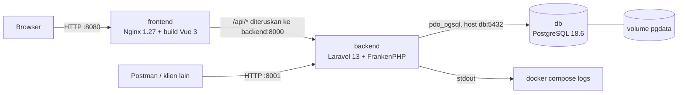
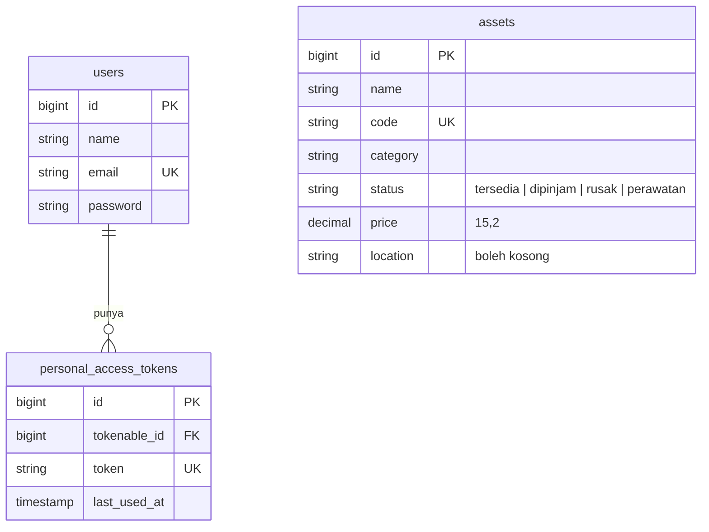
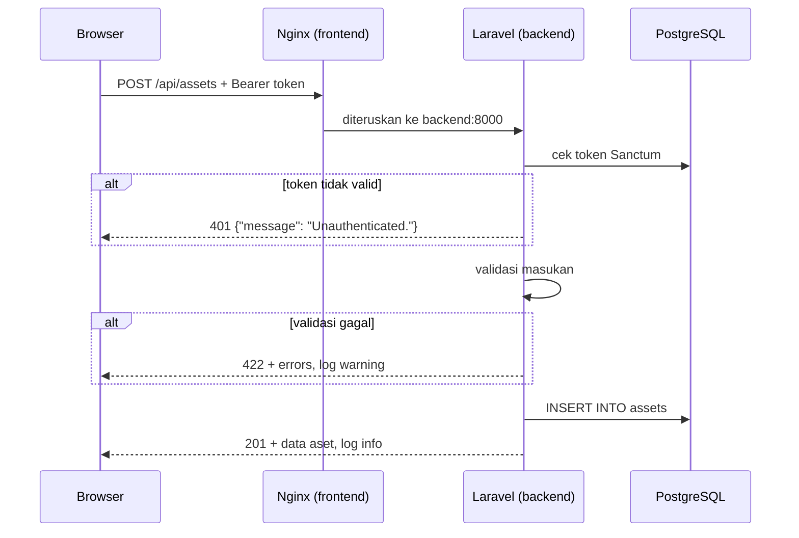

# Arsitektur

## Gambaran umum

Ketiga layanan didefinisikan di `compose.yaml` dan berada di satu jaringan Docker bawaan Compose, jadi mereka saling memanggil dengan nama layanan (`db`, `backend`). Hanya `frontend` dan `backend` yang membuka port ke host. Basis data tidak bisa diakses dari luar jaringan Compose.

## Komponen

### frontend

- Vue 3 dengan Vite, satu komponen utama `src/App.vue` dan klien Axios di `src/api.js`.
- Dibangun dua tahap di `frontend/Dockerfile`: Node 20 menjalankan `npm run build`, lalu hasil `dist/` disalin ke image Nginx. Image akhir tidak membawa Node atau `node_modules`.
- `nginx.conf` melayani berkas statis, mengarahkan rute yang tidak dikenal ke `index.html`, dan meneruskan `/api/` ke `http://backend:8000`. Karena frontend dan API ada di origin yang sama, browser tidak perlu CORS.
- Token disimpan di `localStorage` dan dipasang ke header `Authorization` oleh interceptor Axios. Kalau API membalas `401`, token dihapus dan pengguna kembali ke halaman masuk.

### backend

- Laravel 13 di PHP 8.5, dilayani FrankenPHP (`frankenphp php-server`) di port 8000.
- `docker/start.sh` menjalankan `config:cache`, `migrate --force`, dan `db:seed --force` setiap container mulai. Seeder memakai `firstOrCreate`, jadi data yang sudah diubah tidak tertimpa.
- Autentikasi memakai Laravel Sanctum (token pribadi di tabel `personal_access_tokens`).
- `Dockerfile` menyalin `composer.json` dan `composer.lock` lalu memasang dependensi sebelum menyalin kode, sehingga perubahan kode tidak membatalkan cache layer Composer.
- Log memakai kanal `stdout` (Monolog `StreamHandler` ke `php://stdout`).

### db

- PostgreSQL 18.6 Alpine, data di named volume `pgdata` (bertahan setelah `docker compose down`, hilang dengan `down -v`).
- Kredensial dibaca dari `.env` di akar repo.

## Model data

Tabel `assets` belum terhubung ke `users`. Aplikasi belum mencatat siapa yang membuat atau mengubah aset kecuali lewat log.

## Alur permintaan: menambah aset

## Kesehatan dan log

- `GET /health` (didaftarkan di `bootstrap/app.php`, juga tersedia di `/api/health`) menjalankan `SELECT 1` ke basis data dan menulis lalu membaca kunci acak di cache. Balasannya `200` jika keduanya sehat, `503` jika salah satu gagal, dengan daftar `bagian_bermasalah`.
- `GET /up` adalah rute kesehatan bawaan Laravel yang hanya memastikan aplikasi bisa melayani permintaan.
- Healthcheck `backend` di `compose.yaml` memanggil `/health`, sehingga container berubah menjadi `unhealthy` ketika basis data mati. `frontend` baru dijalankan setelah `backend` sehat, dan `backend` baru dijalankan setelah `db` sehat.
- Setiap log aplikasi memakai kunci `siapa`, `sedang_mengerjakan`, dan `sebab`. Identitas pengguna ditulis sebagai `user_id:<angka>`, bukan email.

## CI/CD

File `.github/workflows/ci.yml` punya tiga job:

1. `Backend Test`: PHP 8.5, layanan PostgreSQL 18.6, lalu `php artisan migrate --force` dan `php artisan test`. `APP_KEY` dan `DB_PASSWORD` diambil dari GitHub Secrets.
2. `Frontend Build`: Node 20, `npm ci`, `npm run build`.
3. `Deploy to GHCR`: hanya pada push ke `main` setelah dua job di atas lulus. Image backend dan frontend didorong ke `ghcr.io/hafidzrizqullahprasetya/uts-p1-535493/{backend,frontend}` dengan tag SHA commit.

Branch `main` dilindungi: perubahan harus lewat pull request dan dua job pertama wajib lulus.

## Keputusan desain

| Keputusan | Alasan | Konsekuensi |
|---|---|---|
| FrankenPHP, bukan PHP-FPM + Nginx terpisah | Satu proses, satu image untuk backend, konfigurasi lebih sedikit | Healthcheck bawaan image (admin endpoint port 2019) tidak jalan dengan `php-server`, jadi diganti healthcheck sendiri |
| Nginx frontend sebagai proxy `/api` | Browser memanggil origin yang sama, tidak perlu mengatur CORS untuk produksi | Backend tetap dibuka di port 8001 untuk Postman dan pengujian |
| Migrasi dan seeder dijalankan saat container mulai | `docker compose up` langsung menghasilkan aplikasi siap pakai | Startup sedikit lebih lama; seeder harus idempoten |
| Cache memakai driver `file` | Tidak perlu layanan Redis untuk skala tugas ini | Pemeriksaan cache di `/health` menguji penulisan ke disk container |
| Penyaringan daftar aset di sisi klien | Jumlah aset kecil, satu permintaan cukup | Perlu paginasi di API jika data bertambah banyak |
